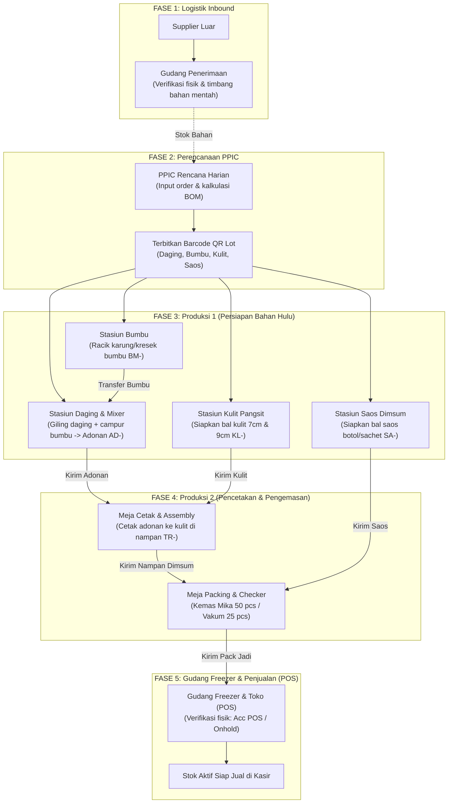

# Panduan Arsitektur & Alur Operasional (Dimsum MES & Traceability)

Dokumen ini memuat rangkuman menyeluruh dari sistem **Manufacturing Execution System (MES) & Traceability** berbasis web mobile-first untuk pabrik pengolahan dimsum, mulai dari logistik bahan masuk supplier, perencanaan produksi, pengolahan adonan di lantai produksi, perakitan dan packing, hingga verifikasi stok fisik siap jual di gudang freezer dan kasir (POS).

---

## 1. Ringkasan Eksekutif Sistem

### A. Latar Belakang & Masalah yang Diselesaikan
Sebelum adanya sistem MES ini, pencatatan produksi dan pergerakan bahan di pabrik rentan terhadap:
- **Selisih Stok Bahan & Kemasan**: Bahan berpindah antarstasiun tanpa bukti serah terima yang jelas.
- **Kesalahan Takaran & Pemborosan**: Perhitungan kebutuhan kilogram daging mentah, karung bumbu, dan lembar kulit masih manual.
- **Ketertelusuran Rendah (*Low Traceability*)**: Kesulitan melacak asal-usul adonan atau nomor lot bumbu jika ditemukan komplain kemasan rusak/cacat di toko.
- **Ketidaksesuaian Hak Akses**: Setiap orang dapat melihat data yang bukan ranah wewenangnya.

### B. Solusi Sistem MES
1. **Ketertelusuran Barcode QR Lot (*End-to-End Traceability*)**: Setiap wadah daging giling, karung bumbu, bal kulit pangsit, bal saos, nampan cetak, dan kemasan jadi (Finished Goods) memiliki nomor barcode unik dengan timestamp dan identitas operator.
2. **Kalkulasi Otomatis BOM (*Bill of Materials*)**: PPIC cukup menginput pesanan mika dan vakum, sistem langsung menghitung gramatur daging, karung bumbu, bal kulit, dan bal saos sesuai resep master.
3. **Pemisahan Peran Dinamis (*Dynamic RBAC*)**: Operator hanya melihat stasiun yang menjadi tugasnya (maksimal 5 tab adaptif di HP), sementara Super Admin memiliki kendali penuh atas pengguna, izin akses, dan harga.

---

## 2. Diagram Alur Kerja Pabrik (End-to-End)

---

## 3. Rincian Proses Tiap Fase (Dari Hulu ke Hilir)

### Fase 1: Logistik Inbound (Penerimaan Bahan Baku)
- **Aktor**: Gudang / Penerima Barang (`opr_gudang`, `pic_gudang`).
- **Aktivitas**:
  1. Menerima kedatangan bahan mentah dari supplier (karkas ayam, daging paha fillet, tepung, bumbu mentah, bal kulit pangsit, saos, plastik mika, dan kantong vakum).
  2. Memeriksa surat jalan dan melakukan penimbangan fisik.
  3. Mencatat barang masuk (*Inbound*) di aplikasi dan mencetak tanda terima/QR jika dibutuhkan.
  4. Memantau ketersediaan stok bahan baku (*Inventory*) dan mencatat pengeluaran bahan (*Outbound*) saat diminta oleh lini produksi.

### Fase 2: Perencanaan & Perhitungan Otomatis BOM (PPIC)
- **Aktor**: PPIC (`ppic_ayu`).
- **Aktivitas**:
  1. **Input Target Produksi Harian**:
     - Dimsum Mika (Order + Bumper cadangan).
     - Dimsum Vakum (Order + Bumper cadangan).
  2. **Kalkulasi Resep Otomatis (Bill of Materials / BOM)**:
     - 1 butir dimsum membutuhkan $\pm 17$ gram adonan kalis.
     - 1 gilingan standar mengolah 15 kg daging ayam mentah dan menghasilkan $\pm 19$ kg adonan kalis (sekitar 1.117 butir dimsum).
     - Menghitung kebutuhan karung bumbu racik Sparta (1 karung untuk 20 gilingan atau kresek eceran per gilingan).
     - Menghitung kebutuhan bal kulit 9 cm (untuk kemasan mika isi 50) dan bal kulit 7 cm (untuk kemasan vakum isi 25).
     - Menghitung kebutuhan bal saos sachet/botol.
  3. **Publikasi Rencana (*Publish Plan*)**:
     - Status rencana berubah dari `DRAFT` menjadi `ACTIVE`/`PUBLISHED`.
     - Data target terkunci dan menjadi panduan kerja di monitor seluruh stasiun.
  4. **Penerbitan Barcode Lot QR Awal**:
     - PPIC mencetak barcode lot QR untuk wadah daging (`DG-...`), bumbu (`BM-...`), kulit (`KL-...`), dan saos (`SA-...`).
  5. **Batch Susulan**: Jika di tengah hari terdapat pesanan tambahan dari manajemen, PPIC dapat menambahkan *Batch 2* atau batch susulan tanpa mengganggu rencana harian awal.

### Fase 3: Produksi 1 (Pengolahan Bahan Hulu di Dapur)
Lini ini terdiri dari 4 stasiun kerja independen:
1. **Stasiun Daging (Giling & Mixer)**:
   - Menerima bahan daging ayam mentah (`DG-...`).
   - Melakukan penggilingan pada mesin giling kasar/halus.
   - Mengambil bumbu racik (`BM-...`), mencampurnya di mesin mixer bersama es batu dan tepung hingga kalis.
   - Menerbitkan nomor wadah adonan (`AD-...`).
   - Melakukan scan kirim (*Scan Out*) adonan menuju Produksi 2 (Meja Cetak).
2. **Stasiun Bumbu**:
   - Menimbang dan meracik formula bumbu rahasia Sparta ke dalam karung/kresek berlabel `BM-...` atau `BS-...`.
   - Melakukan serah terima (*Scan Out*) ke stasiun mixer daging.
3. **Stasiun Kulit Pangsit**:
   - Mempersiapkan dan memotong bal kulit pangsit ukuran diameter **9 cm** (dimsum kukus mika) dan **7 cm** (dimsum beku vakum) berlabel `KL-...`.
   - Melakukan scan transfer (*Scan Out*) ke Meja Cetak.
4. **Stasiun Saos Dimsum**:
   - Mempersiapkan bal saos botol dan sachet berlabel `SA-...` / `SS-...`.
   - Melakukan scan transfer (*Scan Out*) ke Meja Packing.

### Fase 4: Produksi 2 (Pencetakan, Assembly, dan Packing)
1. **Meja Cetak & Assembly**:
   - Menerima adonan (`AD-...`) dan bal kulit (`KL-...`) dengan melakukan *Scan In*.
   - Operator mencetak butir dimsum (isian $\pm 17$ gram) menggunakan kulit pangsit, lalu menyusunnya di atas nampan stainless steel berlabel `TR-...`.
   - Menandai adonan dan kulit yang sudah habis terpakai (*Consumed*).
   - Nampan yang sudah penuh dimuat ke rak transfer untuk dikukus / didinginkan.
2. **Meja Packing & Quality Checker**:
   - Menerima nampan hasil cetak (`TR-...`) dan bal saos (`SA-...`).
   - Melakukan pemeriksaan fisik dan memisahkan butir reject/cacat (data reject dicatat per divisi).
   - Mengemas dimsum ke dalam dua varian kemasan jadi (Finished Goods / FG):
     - **Dimsum Mika** (`FG_MIKA`): Isi 50 butir per kemasan mika (kulit 9 cm) + saos.
     - **Dimsum Vakum** (`FG_VAKUM`): Isi 25 butir per pack vakum beku (kulit 7 cm) + saos.
   - Menerbitkan stiker barcode produk jadi (`FG-MIKA-...` / `FG-VAKUM-...`).
   - Mengirim pack fisik (*Dispatch to Freezer*) ke gudang freezer / toko.

### Fase 5: Gudang Freezer & Penjualan (Toko POS)
- **Verifikasi Fisik Bertahap**:
  - Petugas penerima / kasir toko memeriksa jumlah pack fisik yang diantar dari dapur.
  - Membuka halaman **Produk** $\rightarrow$ memilih jenis kemasan $\rightarrow$ mengisi jumlah fisik.
  - **Tombol Acc**: Jika fisik pack dan segel kemasan dalam kondisi baik, lot diverifikasi $\rightarrow$ status lot berubah menjadi `IN_SALES_STOCK` / `IN_FREEZER_STORAGE` dan otomatis aktif di sistem kasir/POS.
  - **Tombol Onhold**: Jika ditemukan kemasan bocor, kotor, atau jumlah kurang, lot ditandai *Onhold* $\rightarrow$ tercatat ke log selisih (*Discrepancy Log*) untuk diaudit oleh PIC.
- **Katalog Produk POS**:
  - Mengelola data master produk (Nama, Spesifikasi kemasan, Deskripsi).
  - Mengunggah foto produk persegi rasio 1:1 (otomatis dipotong dan dioptimasi ke format WebP 800x800 px dan thumbnail 200x200 px).
  - Mengatur harga jual rupiah (khusus Super Admin / peran pemegang izin Ubah Harga).

---

## 4. Mekanisme Barcode & Rantai Kustodi (Chain of Custody)

Setiap entitas fisik dalam alur produksi memiliki standar penomoran QR barcode:
- `DG-[YYYYMMDD]-[SEQ]`: Wadah daging ayam mentah.
- `BM-[YYYYMMDD]-[SEQ]`: Karung / pouch bumbu racik.
- `KL-[YYYYMMDD]-[SEQ]`: Bal kulit pangsit (7 cm / 9 cm).
- `SA-[YYYYMMDD]-[SEQ]`: Bal saos dimsum (botol / sachet).
- `AD-[YYYYMMDD]-[SEQ]`: Wadah adonan kalis hasil mixer.
- `TR-[YYYYMMDD]-[SEQ]`: Nampan stainless steel meja cetak.
- `FG-[PROD]-[YYYYMMDD]-[SEQ]`: Pack produk jadi mika / vakum.

### Validasi Serah Terima Antarstasiun
- **Scan Out (Transfer Keluar)**: Operator stasiun pengirim men-scan barcode untuk mencatat bahwa bahan sedang dipindahkan ke stasiun tujuan.
- **Scan In (Penerimaan Masuk)**: Operator stasiun penerima men-scan barcode untuk mengonfirmasi bahwa bahan sudah diterima secara fisik.
- **Dukungan Mode Scan 1X & 2X**: Sistem mendukung scan langsung (1X) untuk kecepatan tinggi atau konfirmasi ganda (2X) untuk meminimalkan salah scan pada stasiun kritis.

---

## 5. Matriks Peran Pengguna (RBAC) & Tanggung Jawab

| Peran (Role) | Tanggung Jawab Utama | Tab / Halaman Akses |
| :--- | :--- | :--- |
| **Super Admin** | Akses tertinggi administrasi sistem. Mengatur akun pengguna, hak akses peran kustom, log audit keamanan, dan nominal harga produk. | **Admin (Akun, Role, Log) \| Profil** *(Tidak mengakses stasiun teknis pabrik)* |
| **PPIC** | Perencanaan target harian, perhitungan formula BOM, penerbitan barcode QR lot bahan baku, rekapitulasi harian, dan ekspor laporan Excel. | **Rencana \| Rekap PPIC \| Barang Masuk \| Riwayat \| Profil** |
| **Gudang / Penerima Barang** | Penerimaan bahan baku supplier (*Inbound*), pengeluaran bahan ke lantai produksi, dan kontrol stok freezer. | **Barang Masuk \| Riwayat \| Profil** *(Produksi 1)* **Produk \| Riwayat \| Profil** *(Produksi 2)* |
| **Produksi Giling & Mix** | Menggiling daging ayam mentah, mencampur bumbu racik, dan menghasilkan wadah adonan kalis. | **Giling & Mix \| Riwayat \| Profil** |
| **Produksi Bumbu** | Meracik formula bumbu rahasia Sparta ke dalam karung/kresek dan serah terima ke mixer. | **Bumbu \| Riwayat \| Profil** |
| **Produksi Kulit Dimsum** | Memotong dan menyiapkan bal kulit 7 cm & 9 cm untuk meja cetak. | **Kulit \| Riwayat \| Profil** |
| **Produksi Saos** | Menyiapkan bal saos botol dan sachet untuk meja packing. | **Saos \| Riwayat \| Profil** |
| **Meja Cetak** | Menerima adonan & kulit, mencetak butir dimsum, dan menyusunnya di nampan stainless steel. | **Cetak \| Riwayat \| Profil** |
| **Meja Packing** | Menyortir butir dimsum, mengemas mika 50 pcs / vakum 25 pcs, menempel barcode FG, dan kirim ke freezer. | **Packing \| Riwayat \| Profil** |
| **Viewer** | Hak akses pemantauan (*read-only*) untuk mengamati seluruh stasiun tanpa tombol operasional / scan. | **Seluruh stasiun pemantauan \| Profil** |

---

## 6. Siklus Harian Operasional Pabrik

| Jam Kerja | Aktivitas Operasional |
| :--- | :--- |
| **06.00 – 08.00** | Logistik menerima kedatangan ayam & bumbu mentah dari supplier $\rightarrow$ PPIC menginput target rencana harian dan menerbitkan barcode lot QR. |
| **08.00 – 12.00** | Stasiun Bumbu & Kulit memproses bahan hulu $\rightarrow$ Stasiun Daging menggiling & me-mixing adonan $\rightarrow$ Meja Cetak mulai mencetak butir dimsum. |
| **12.00 – 15.30** | Lini pengukusan dan Meja Packing menyortir dan mengemas kemasan mika & vakum $\rightarrow$ mengirim produk jadi ke freezer. |
| **15.30 – 17.00** | Petugas Toko/Sales melakukan **Acc Penerimaan** di halaman Produk untuk mengaktifkan stok kasir $\rightarrow$ Kasir POS melayani penjualan. |
| **17.00 – 18.00** | PPIC memeriksa selisih (*discrepancy*), mengisi catatan operasional, dan mengunduh Rekap Harian Excel $\rightarrow$ Super Admin meninjau Log Aktivitas. |
